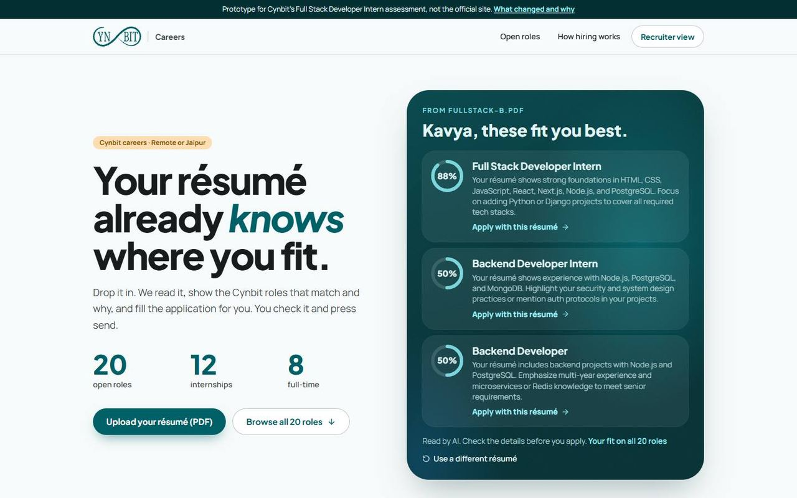
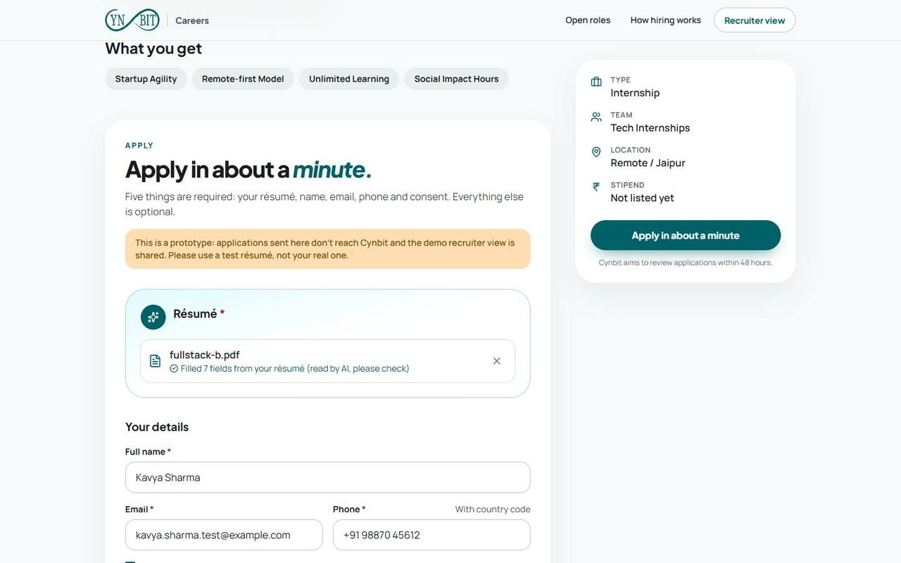
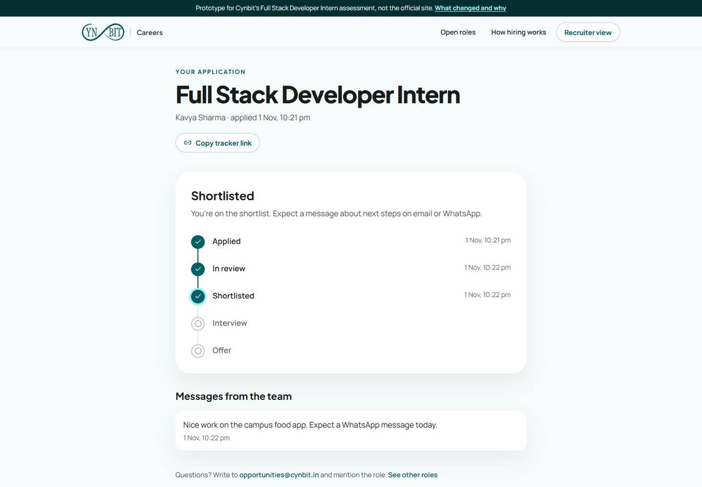
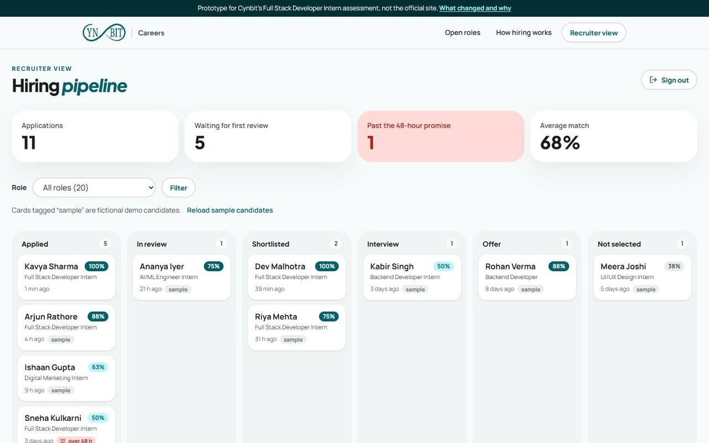
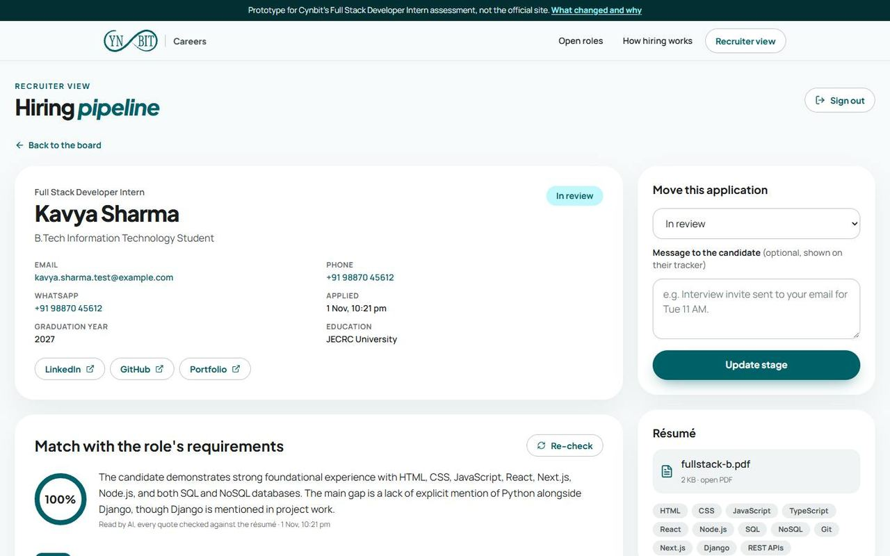

# Cynbit careers, rebuilt

A working prototype of a better hiring flow for [cynbit.in/careers](https://www.cynbit.in/careers), built for Cynbit's Full Stack Developer Intern assessment.

Live: https://cynbit-careers-beta.vercel.app · Report: [`docs/REPORT.md`](docs/REPORT.md) · Recruiter demo password: `cynbit-demo-2026`

> Prototype only. Applications sent here don't reach Cynbit, and the recruiter view is shared with anyone who has this README. Please use a test résumé.



<table>
  <tr>
    <td width="50%"><br><sub>The form fills itself from the résumé</sub></td>
    <td width="50%"><br><sub>Every candidate gets a private tracker</sub></td>
  </tr>
  <tr>
    <td width="50%"><br><sub>Recruiter board with the 48-hour alert</sub></td>
    <td width="50%"><br><sub>Match against the role's own requirements</sub></td>
  </tr>
</table>

## The problem

I went through Cynbit's careers pages as a candidate and as a developer. This is what I found:

| On cynbit.in today | Why it matters |
| --- | --- |
| The apply form has 22 fields, 21 required, including date of birth, gender, permanent address and notice period, even for interns | Long forms lose candidates, and most of that data isn't needed to screen anyone (data minimisation under India's DPDP Act, 2023) |
| No résumé upload, only a link field | Candidates have to host their PDF somewhere first |
| After applying you see a toast, nothing else | The page promises a review "within 48 hours", but nobody can check it |
| 20 roles, no filters, roles start below three "why us" sections | Hard to find the right role |
| No `JobPosting` structured data on job pages | The roles can't appear in Google's job search |
| `/careers` scores 56 on Lighthouse mobile, LCP 11.0 s | Page content starts at `opacity: 0` until ~600 KB of JS runs, plus a 1.14 MB icon font |

## What I built

### For candidates

- You can drop a résumé on the careers page and see where you fit. It reads the PDF and ranks all 20 roles against it, with a short "why" for the top three.
- Applying takes about a minute. The form fills itself from the résumé, and there are five required inputs instead of twenty-one. It also works with JavaScript turned off.
- Every application gets a private tracker link that shows its stage with dates, plus any message the team adds.

### For Cynbit's hiring team (`/recruiter`)

- A pipeline board: Applied → In review → Shortlisted → Interview → Offer / Not selected.
- A count of applications past the 48-hour review promise.
- Each application is checked against the role's own listed requirements (met / partly / not shown), each with a quote from the résumé. Opening an application marks it "In review" on the candidate's tracker.

### For search and sharing

- `JobPosting` JSON-LD on all 20 role pages, per-role titles, canonical URLs, a sitemap, and a generated PNG share image per role.

## Results

| | cynbit.in | This prototype |
| --- | --- | --- |
| Required inputs to apply | 21 | 5 |
| Status after applying | a toast | private tracker |
| Roles with JobPosting data | 0 / 20 | 20 / 20 |
| Lighthouse mobile, `/careers` | 56 | 94 |
| Phone LCP, `/careers` | 11.0 s | 2.4 s |
| Lighthouse desktop, `/careers` | 87 | 100 |
| Lighthouse mobile, a role page | 54 | 97 |

Lighthouse 12.8 medians of 3 runs, both sites tested back to back on the same machine (1 Nov 2026). End-to-end: 23/23 checks pass against the live site, including applying with JavaScript disabled.

## How the AI part stays honest

Résumé reading and matching use Google Gemini. These are the guardrails:

1. Contact details must literally appear in the PDF. If the model returns an email or phone that isn't in the text, I throw it away and use the rule-based value.
2. Every "met" needs a quote. The model has to quote the résumé for each requirement, and if the quote isn't in the text, the verdict is downgraded.
3. The score is computed in code from those verdicts (met = 1, partly = ½). The model never picks the number.
4. The model is told to ignore name, gender, age, college prestige and location, and to treat the résumé as data, so instructions written inside a résumé are ignored.
5. Everything has a rule-based fallback. If the key is missing, the model times out (12-15 s) or it returns bad JSON, parsing and matching still work, and the UI says which engine was used.
6. A person moves every stage. The score helps someone read faster; it doesn't reject anyone.

## Stack

I matched Cynbit's own site so this can be merged into the existing codebase:

| | |
| --- | --- |
| Framework | Next.js 15.5 App Router, React 19, Server Actions (same as cynbit.in) |
| Styling | Tailwind CSS v4 with Cynbit's own Material 3 colour tokens, Plus Jakarta Sans + Manrope |
| Database | Postgres via Drizzle ORM: Neon in production, PGlite (Postgres in WASM) locally, so it runs with zero setup |
| PDF text | `unpdf` |
| AI | Gemini (`gemini-3.5-flash-lite`) via `@google/genai`, structured JSON output, validated with Zod |
| Auth | Signed HTTP-only cookie (`jose`) for the recruiter area |
| Tests | Vitest (parsing, matching, scoring) and a headless-browser end-to-end run |

## Run it locally

```bash
npm install
cp .env.example .env.local   # add a Gemini key (optional: rules work without it) and a recruiter password
npm run seed                 # optional: 8 clearly labelled sample candidates
npm run dev                  # http://localhost:3000/careers
npm test
```

Without `DATABASE_URL` the app uses a local PGlite database in `.data/`.

## Project layout

```
src/app/careers            careers board + role pages (static, with JobPosting JSON-LD)
src/app/applications       candidate tracker (private token link)
src/app/recruiter          sign-in, pipeline board, application detail
src/app/actions            server actions: read résumé, apply, move stage, re-check match
src/lib/resume             PDF intake, rule-based and Gemini parsing
src/lib/match              rule-based ranking, Gemini requirement checks, scoring
src/lib/db                 Drizzle schema, Neon / PGlite connection
src/data/roles.json        the 20 roles, copied verbatim from cynbit.in/careers (1 Nov 2026)
scripts/seed.ts            sample candidates (stored with is_sample = true)
```
